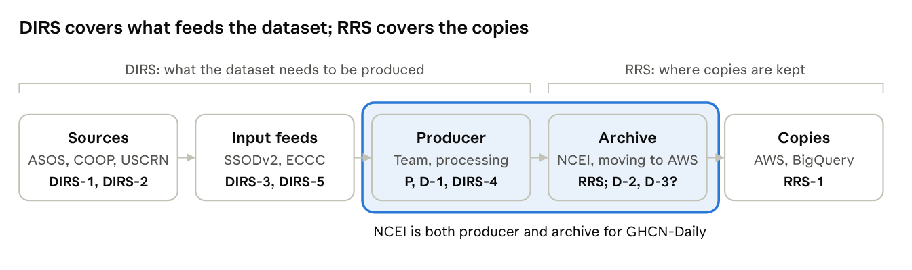

# Why R* categories are hard to apply

As of 2026-11-23. Copy of the Claude Doc [Why R* categories are hard to apply](https://claude.ai/artifact/Q5rmmJHnFzAtNLHsubpZKW);
edits made online after this date are not in this file.

The user's answers were added under each `<reply>` on 2026-11-23. This file is kept as a record. The follow-up,
with what was decided and the remaining questions, is
[why-rstar-categories-are-hard-to-apply_follow-up.md](why-rstar-categories-are-hard-to-apply_follow-up.md).

## Purpose

The R* subcategories are easy to read but hard to apply: the same fact often fits two or three subcategories, and one
organization can be producer, steward and repository at once. This note lists where sorting web research into the 19
subcategories needed a judgment call, with examples from GHCN-Daily (three categorization passes, 210 evidence items),
and suggests changes that could make the rules clearer.

The four groups, as worded now:

- **People risk (P-1 to P-4):** the people who keep the dataset going — succession, retirement, undocumented knowledge,
  single points of failure.
- **Data risk (D-1 to D-5):** threats to the dataset as a product — defunding, storage, access, formats, politics.
- **Dependent infrastructure resilience (DIRS-1 to DIRS-5):** what the dataset needs in order to be produced —
  instruments and networks, their calibration, input feeds, processing, backups.
- **Repository resilience (RRS-1 to RRS-5):** how well the places that hold copies keep them — redundancy, checksums,
  disaster recovery, funding, track record.

R* = 0.40 D + 0.30 P + 0.20 (100 − RRS) + 0.10 DIRS. Each subcategory scores 0 or its points, and 0 when the evidence
is missing.

## Dataset, producer, repository: one organization can be all three

The hardest sorting problem is deciding which role a fact is about. For GHCN-Daily, NOAA NCEI produces the dataset,
stewards it and holds the archive copy, so almost every NCEI fact (budget, staff losses, the move to AWS, Hurricane
Helene) could be read as P, D, DIRS or RRS evidence.

| Role | GHCN-Daily | IMERG Late Run | Which group it feeds |
| --- | --- | --- | --- |
| Sources that make the measurements | About 30 station networks: COOP, ASOS, USCRN, CoCoRaHS, SNOTEL, national weather services | Microwave and infrared satellites (GMI, SSMIS, AMSR2, ATMS, MHS, geostationary IR) | DIRS-1, DIRS-2 |
| Input feeds and routes | GSOD, then SSODv2 from GHCNh; ECCC; ECA&D; Regional Climate Centers; WMO exchange | CPC merged IR, GEOS FP, JMA forecast, Autosnow, PDIR-Now (CHRS) | DIRS-3, DIRS-5 |
| Producer (people and processing) | NCEI's GHCN-Daily team, now Menne plus contractors | NASA GSFC IMERG team; NASA PPS runs it | P, DIRS-4 |
| Program and funding | NCEI budget line inside NESDIS | NASA Earth science; GPM mission funding | D-1 |
| Repository of record | NCEI archive (Asheville, moving to AWS) | NASA GES DISC (Earthdata Cloud) | RRS, and D-2/D-3? |
| Copies | AWS `noaa-ghcn-pds`, Google BigQuery, Data Rescue Project snapshot | PPS's own site, dynamical.org Zarr, Google Earth Engine | RRS-1 |

Because one organization fills the two shaded roles, its budget and staff facts touch P, D-1, D-2, D-3 and RRS at once.

**Where it went wrong in practice:**

- Four NCEI-wide items (the archive's AWS move, NCEI support contracts, Helene, the migration contractors) were first
  filed under DIRS-4 "external processing". They describe the repository, not GHCN-Daily's processing, and were
  removed in the third pass.
- ASOS looked like an NCEI item but is a GHCN-Daily source network (source flags A, B, M and W), so ASOS evidence
  belongs in DIRS.
- D-2 (storage) and D-3 (access) are almost all NCEI evidence now and overlap RRS-1 and RRS-4. Whether they should be
  about the dataset's own storage and access routes, or the repository, is not decided.
- NCEI's 2025 staff losses (58 departures) went into P-1 and P-2 although no source ties them to the GHCN-Daily team.

## Where subcategories overlap

Nine pairs of subcategories share ground; for each, one GHCN-Daily fact could go in either, and the choice now rests on
judgment.

| Pair | Example fact | Could be | How it was filed |
| --- | --- | --- | --- |
| D-2 storage vs RRS-1 redundancy | NCEI's offsite tape copy is 12.5 miles from Asheville | a single point of failure (D-2) or no independent copy (RRS-1) | Both |
| D-3 access vs RRS-4 funding | The AWS and BigQuery copies rest on NODD contracts with no published end | fragile access (D-3) or unstable repository funding (RRS-4) | Both |
| D-1 defunding vs RRS-4 funding | NCEI's FY2027 request is 25% below its base | a threat to the program (D-1) or to the repository (RRS-4) | Both, because NCEI is both |
| DIRS-2 networks vs DIRS-3 supply chain | 1,371 foreign stations stopped reporting to GHCN-Daily, but still operate | a network at risk (DIRS-2) or a lost route (DIRS-3) | DIRS-3, since the stations still run |
| DIRS-1 calibration vs QC | NCEI runs its own automated QC tests | calibration dependency (DIRS-1) or processing (DIRS-4) | DIRS-1, because the old "How to find" asked about QC; now reworded |
| DIRS-4 processing vs repository IT | NCEI's archive moves to AWS by spring 2027 | outside processing (DIRS-4) or storage (D-2) | Moved from DIRS-4 to D-2 in the third pass |
| DIRS-5 backup vs substitute dataset | ECA&D, C3S and WIS2 cover parts of GHCN-Daily | no backup for a dependency, or no substitute for the dataset | DIRS-5 now counts both (decided 2026-11-23) |
| P-1 succession vs P-4 single person | Durre left in April 2025 with no named successor | no succession plan (P-1) or one person left (P-4) | Both |
| D-1 / D-5 vs DIRS-2 | The ARL lab that maintains USCRN is proposed for closure | defunding, politics, or a network at risk | DIRS-1 and DIRS-2 only |

Repeating a fact in two subcategories makes each one readable alone, but it may count the same evidence twice in the
score. Cross-referencing ("see D-2") avoids that but makes a subcategory hard to judge without the others.

## Judgment calls inside one subcategory

Even when the subcategory is clear, deciding whether the evidence is "for" or "against" its statement needs rules that
are not written down yet. The scoring guide gives a subcategory its full points when the evidence is "tilted towards
for", and 0 otherwise, so each of these calls can flip a score.

| Issue | GHCN-Daily example | Why it is hard |
| --- | --- | --- |
| RRS is worded the other way | RRS-2 "checksum checks quarterly or more often" is a strength; P, D and DIRS statements are risks | "For" means resilience in RRS and risk elsewhere, so the same tag reads opposite ways |
| Missing evidence scores 0 | RRS-2 and RRS-3 have no "for" items | 0 reads as "no risk" for P, D and DIRS but "no resilience" for RRS, which then adds risk through (100 − RRS) |
| Not searched vs not found vs not public | NCEI's disaster-recovery plan "cannot be shared outside the US Government" | Three different kinds of absence get the same tag today |
| How direct a link must be | NWS-wide technician losses; NIST calibration staff down 25–50%; NCEI's 58 departures | None names GHCN-Daily; each is one step removed |
| How much of a compilation must be affected | CoCoRaHS is 40% of station entries; USCRN is small but a reference network; Argentina's SMN cuts | No threshold for "the dataset depends on it" |
| Proposed vs enacted | ARL's closure is in the FY2026 and FY2027 requests; Congress rejected it once; the enacted FY2026 statement is silent | Imminent, emerging and "no current threat" are rated by the research, not by the subcategory |
| Conflicting sources | OIG-24-034-A recommendations open (Sept 2025) vs "Closed" (Oversight.gov); NODD's ten-year term vs IDIQs ending 2025 | Which source wins, and whether a conflict counts as "for" |
| Time window | D-1 and RRS-4 ask about 2025 to now; Helene was September 2024 | Unclear whether older events count as track record or as current risk |
| Estimates as evidence | Ages from earliest publication year minus 25–30; contractors aren't under federal retirement rules | P-2 rests on low-confidence inferences |
| Data quality has no home | QC tests, the lack of homogenization, metadata faults | None of the 19 subcategories asks about quality, so these items land in DIRS-1 or D-4 |
| Repositories pooled | NCEI, AWS and BigQuery have different redundancy and funding | RRS gives one verdict for all copies |

## Suggestions that could make the categories clearer

The first three would remove most of the overlap; the rest settle the judgment calls. Listed roughly in order of
impact.

1. **A scope sentence for every group, like the one DIRS now has.** For example: P = people on this dataset's own team;
   D = the dataset as a product (its program, formats, politics); DIRS = what it needs to be produced; RRS = each place
   that holds a copy, as an institution.

<reply>
add this

2. **Decide where storage and access live.** Either D-2 and D-3 cover only the dataset's own primary copy and routes,
   and RRS covers the repositories; or storage and access move into RRS and D keeps program, formats and politics.

<reply>
since the dataset is served by the repository, it does depend on the repository and so the repository evidence is relevant for the data risk category. it's ok if evidence is duplicated between categories.

3. **A "directly tied" test.** A fact counts only if a source names the dataset, or names something on its documented
   source list, input list or team. Anything one step removed (agency-wide staff losses, NIST capacity) is context,
   tagged neutral.

<reply>
yes, A fact counts only if a source names the dataset, or names something on its documented source list, input list or team. Anything one step removed (agency-wide staff losses, NIST capacity) is context, tagged neutral. I like having the context so I have relevant information to determine a score because there will be both evidence for and against.

4. **One primary home per kind of fact, with cross-references.** Turn the overlap table above into a lookup:
   "repository funding → RRS-4; program funding → D-1", and cite rather than repeat.

<reply>
repeat the information.

5. **Write every statement in the same direction.** Reword RRS as risks ("no verified copy at a second site"), or state
   in each RRS file that "for" means resilient. Then say what missing evidence scores in each group.

<reply>
Keep the wording of RRS. RRS is confusing because a positive score and evidence for it is not like the other categories. For the total R* score, the contribution is (100-RRS)*0.2, and so an increasing RRS score actually lowers the total risk because of the substraction part of the score (100-RRS).

6. **Separate evidence status from stance.** Add a status to each subcategory: found, searched and none found, not
   public, or not searched. Only "found" items would tilt the score.

<reply>
Add the status. Add tags in addition to the for, against and neutral tags to indicate found, searched and none found, not public, or not searched.

7. **Define "tilted towards for".** For example: count only high and moderate items, ignore neutral ones, and say what
   a tie scores.

<reply>

For the scores, ignore neutral evidence.

If there is only high and moderate "for" evidence and no "against" evidence, the subcategory gets a non-zero score from the subcategory values set. If there is "against" evidence and no "for" evidence, the subcategory gets a score = 0. If there is both "for" and "against" evidence or just neutral evidence or missing evidence, the score is "NA".

On the website, each subcategory card can have a Score value. The subcategory score should be very visible and not a gray color.

8. **Thresholds for compilations.** For example, a source network counts if it supplies a set share of stations or
   values, or is a reference network.

<reply>
Explain this in more detail.

9. **Rules for threat stage and conflicts.** Say whether a proposed cut counts as "for" or only an enacted one, and
   which source wins a conflict (for example the latest primary source).

<reply>
Both a proposed cut and an enacted one count as "for" evidence.

10. **Score RRS per repository,** then combine (weighted by which copy users rely on), instead of one pooled verdict.

<reply>
This is a good point. For now it's a pooled verdict. So if there is more than one data repository, "for" evidence and "against" evidence should appear for each repository and the score determined on "for" and "against" evidence regardless of which repository it refers to. But add an indicator to each RRS subcategory card that there is a single repository or multiple repositories for the dataset.

11. **Give data quality a home,** as a new D subcategory or a note outside the score.

<reply>
The R* formula is fixed and it can't be modified and no new subcategories can be added.

12. **Add "counts / doesn't count" examples to each definition file,** including one each for a station compilation
    (GHCN-Daily) and a satellite product (IMERG).

<reply>
Explain this in more detail.

## Questions to discuss with a colleague

- [ ] When the producer and the repository are the same organization, should its funding and staff count once (where?)
  or in every group they touch?

<reply>
When the producer and the repository are the same organization, its funding and staff count once as evidence. Mention that the producer and repository are the same organization.  Explain more about the question of where.

- [ ] Should D-2 and D-3 be about the dataset's own storage and access, with repositories only in RRS?

<reply>
D-2 and D-3 include both the dataset and repository information because the dataset lives in the repository and this counts as infrastructure. D-2 describes data going offline and this would occur if the repository went offline.

- [ ] How direct must a link be? Does an agency-wide loss count if no source names the dataset's team or inputs?

<reply>
I think you are talking about an agency like NOAA has a loss and at the same time, NOAA funds the dataset's team or inputs, but the numbers only refer to NOAA. Add this as "neutral" evidence and keep it as context if the dataset's team or inputs aren't directly named.

Rename "neutral" evidence to "context"

- [ ] For a compilation of about 30 sources, how big must one source be before its risk is the dataset's risk?

<reply>
Count it as a risk if it involves a source. It doesn't matter how big it is because the total dataset as it currently is defined is a composite of all the sources, so if one is at risk, the currently defined composite is at risk.

- [ ] Should a proposed cut count the same as an enacted one, given that the score is all-or-nothing?

<reply>
Count the proposed count the same as an enacted one.

- [ ] Should missing evidence score 0 everywhere, or be shown as "unknown" and left out of R*?

<reply>
Let's show it as NA and the R* score be NA. Then a user will know the R* value is incomplete and they can decide if it should be 0 because no web search evidence exists for that dataset. Evidence may exist through verbal communication and not show up in a web search, and the user can use that information to determine the score.

There is going to be a web form that the user fills out the final score and the web search information and scores gathered from web research evidence will fill in items on that web form. And NA scores will be indicated on the web form as needing a decision. For my graph idea, I'm thinking a NA score can be designated with a color like black and have the value NA.

- [ ] Should RRS be scored per repository, and if so how are the copies weighted?

<reply>
The RRS will be scored using all of the repositories used by the dataset. As an example, if there is only one repo, the score is just for one repository. If there are two or more, than there can be 'for' evidence for one repo and 'against' for another repo. And this results in a NA score because it needs a users input.

- [ ] Does data quality belong in R*, and where?

<reply>
There is no data quality score, so it won't be part of R*. R* assumes the data quality is good to begin with. If there is an interruption in the data or a drop in quality, that would be evidence of a risk.

- [ ] Is one fact in two subcategories double counting, or the right picture?

<reply>
It's OK to have one fact in multiple subcategories. The web search information can be evidence for more than one subcategory. The R* score is to give people a score to start with to judge the stability of a dataset and is not a scientifically defined formula with exact subcategory separation.

- [ ] Would the statements be easier to apply if they were all written as risks?

<reply>
Keep them as it is. The formula was already determined. In the future, the information gathered from the web research and calculating R* scores will inform if and how the score should be recalculated.

Open questions 2 to 6 in [first_pass_to_categorize.md](first_pass_to_categorize.md) cover some of the same ground.

<reply>

Include these questions when a second version of this doc is created as a follow up. Keep your questions and my replies as a record of this conversation.

